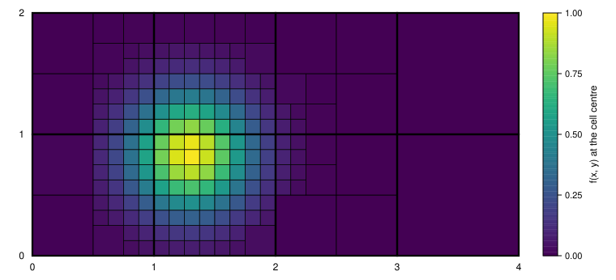

# Fortran vtkHyperTreeGrid Tutorial

**Read it online: [omdaniel.github.io/fortran-vtkHyperTreeGrid-tutorial](https://omdaniel.github.io/fortran-vtkHyperTreeGrid-tutorial/)**

Adaptive quadtrees in modern Fortran: depth first to vtkHyperTreeGrid.

A small, self-contained tutorial code. It builds an adaptive quadtree depth first
(recursive refinement of a smooth f(x,y) down to level 3), grows it into a forest of
quadtrees on a coarse grid, and lays the forest out breadth first as vtkHyperTreeGrid
stores it (Descriptors, NumberOfVerticesPerDepth, TreeIds, DepthPerTree, cell data).

The forest above has eight root cells on a 4 x 2 grid. Each leaf is coloured by f at its
centre through the perceptually uniform viridis colour map, on a scale covering the range
of f, 0 to 1. Thick lines are root cell boundaries.

## Files

- `TUTORIAL.md`: the tutorial, step by step (also built as a web page in `docs/`)
- `quadtree_mod.f90`: tree type, depth-first refinement, breadth-first conversion, checks
- `field_mod.f90`: the cherry-picked Gaussian bump being mapped
- `single_tree.f90`: one tree on the unit square
- `forest.f90`: a 4 x 2 forest and its grid-wide arrays
- `export_cells.f90`: writes every cell of both examples to `cells_single.txt` and `cells_forest.txt`
- `make_figures.py`: draws the SVGs in `figures/` from those files (Python standard library only)
- `make_site.py`, `site/`: build the styled GitHub Pages version of the tutorial into `docs/` (needs pandoc)
- `viridis256.txt`: the 256-entry viridis colour table (CC0), used for the coloured figures
- `single_tree_output.txt`, `forest_output.txt`: program output from gfortran 13.3.0

Build and run with `make run` (Fortran 2008 or later; no other dependencies).
Regenerate the figures with `make figures`, and the web page with `make site`.
[TUTORIAL.md](TUTORIAL.md) walks through the code and the other figures in `figures/`.
The published page is served by GitHub Pages from the `docs/` folder of `main`.

## Caveats

**Not 2:1 balanced.** Each tree refines on its own, and nothing enforces a 2:1 balance
criterion, either within a tree or across the boundaries between root cells. The end state
is unbalanced: inside trees 0, 2 and 4, level-1 leaves sit directly against level-3 leaves,
and across the root boundary at x = 2, level-3 leaves in tree 1 touch a level-1 leaf in
tree 2. A more
fully featured implementation would enforce 2:1 balance, refining any leaf whose
face neighbour is more than one level finer and letting that refinement ripple across root
boundaries into neighbouring trees.

**Not robust sampling.** The refinement test samples five points per cell, so features
narrower than a cell can be missed entirely. The example function was chosen so that this
does not happen; this is not robust for real-world function mapping.
