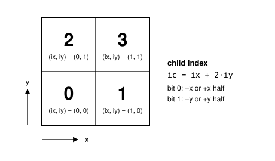
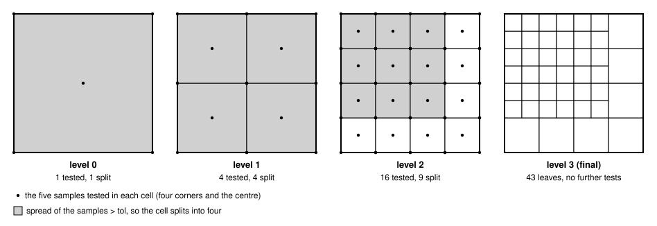
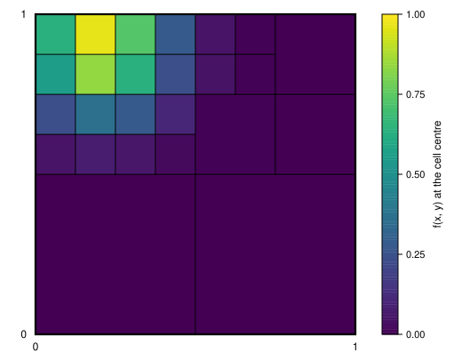
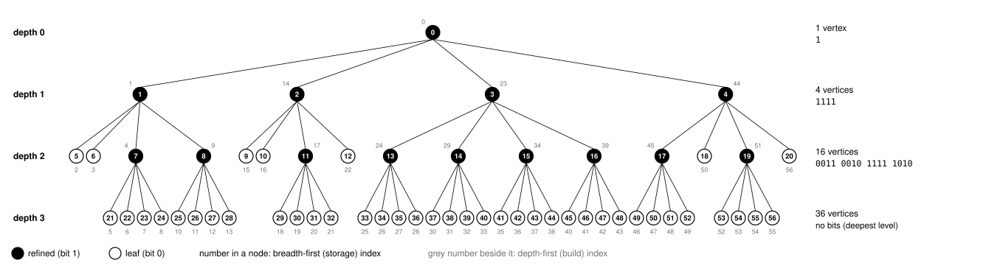
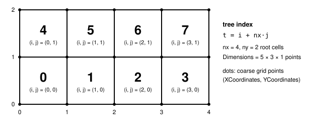
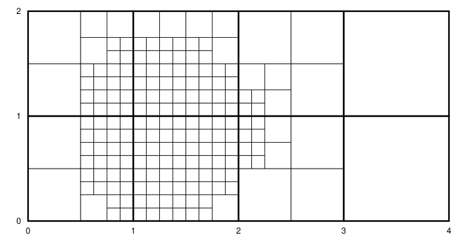
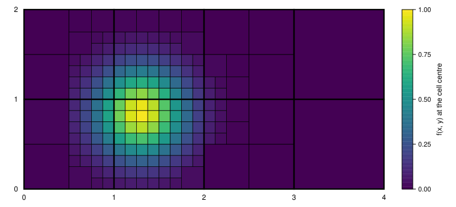

# Naive adaptive quadtrees in modern Fortran: from depth-first to vtkHyperTreeGrid

## Overview

This tutorial builds an adaptive quadtree in plain modern Fortran, depth first, and then shows how the same tree is laid out breadth first, the way vtkHyperTreeGrid stores it. It starts with one tree, grows to a forest of trees over a coarse grid of root cells, and ends with the exact arrays a vtkHyperTreeGrid writer needs: Descriptors, NumberOfVerticesPerDepth, TreeIds, DepthPerTree and the cell data.

The code is self-contained: two small modules and three short programs, about 560 lines of Fortran in all, plus a small figure script, standard Fortran 2008 (it compiles cleanly with `-std=f2018 -Wall` under gfortran 13.3). It has no dependency on VTK or HDF5; the point is the data layout, not the file I/O.

| File | What it holds |
| --- | --- |
| `quadtree_mod.f90` | The tree type, depth-first refinement, the breadth-first conversion and checks |
| `field_mod.f90` | The function being mapped, a smooth Gaussian bump |
| `single_tree.f90` | Parts 1 and 2: one tree on the unit square |
| `forest.f90` | Part 3: a 4 x 2 forest and its global arrays |
| `export_cells.f90` | Writes every cell of both examples to text, for the figures |
| `make_figures.py` | Draws the SVG figures (Python standard library only) |
| `viridis256.txt` | The viridis colour table (CC0) used for the coloured figures |
| `TUTORIAL.md` | This tutorial, as Markdown |
| `make_site.py`, `site/` | Build the styled GitHub Pages version of this tutorial into `docs/` (needs pandoc) |
| `Makefile` | `make run` builds and runs the programs; `make figures` redraws the figures; `make site` rebuilds `docs/` |

The function is cherry-picked on purpose. It is a single Gaussian bump whose width is comparable to the root cell size, so the simple five-point refinement test used here always sees it. Real functions with features narrower than a cell can slip between the samples and never trigger refinement; this example does nothing about that, and the method is not robust for real-world function mapping (see the last section).

## Part 1: one quadtree, built depth first

A depth-first tree is the natural thing to write in Fortran: a derived type whose children are an allocatable array of the same type. Recursive allocatable components are Fortran 2008, so no pointers and no manual deallocation are needed; the whole tree is freed when the root goes out of scope.

```fortran
integer, parameter :: MAX_LEVEL = 3   ! the root is level 0
integer, parameter :: NCHILD = 4

type :: qnode
  integer  :: level = 0
  real(dp) :: x0 = 0, y0 = 0      ! lower-left corner
  real(dp) :: h = 1               ! edge length (square cells)
  real(dp) :: value = 0           ! f sampled at the cell centre
  type(qnode), allocatable :: child(:)   ! child(0:3) when refined
end type qnode
```

A leaf is simply a node whose `child` is not allocated, so `allocated(node%child)` is the refined flag. Every node, refined or not, keeps a value; vtkHyperTreeGrid also stores a value for every cell, not only for leaves.

The function to map is passed in through an abstract interface, so the tree code knows nothing about it:

```fortran
abstract interface
  pure function field2d(x, y) result(f)
    import :: dp
    real(dp), intent(in) :: x, y
    real(dp) :: f
  end function field2d
end interface
```

The refinement test samples f at the four corners and the centre of a cell and refines when the spread of those five samples exceeds a tolerance. Refinement stops at level 3, so a terminal leaf is at most 1/8 of the root cell on a side.

```fortran
logical function needs_refinement(node, f, tol)
  type(qnode), intent(in) :: node
  procedure(field2d) :: f
  real(dp), intent(in) :: tol
  real(dp) :: s(5)
  associate (x0 => node%x0, y0 => node%y0, h => node%h)
    s = [ f(x0, y0), f(x0 + h, y0), f(x0, y0 + h), f(x0 + h, y0 + h), &
          f(x0 + 0.5_dp*h, y0 + 0.5_dp*h) ]
  end associate
  needs_refinement = (maxval(s) - minval(s)) > tol
end function needs_refinement
```

The build itself is one recursive subroutine. Depth first means a child's whole subtree is finished before its next sibling is started. The children are numbered the way VTK numbers them: child index ic = ix + 2\*iy, so bit 0 picks the -x or +x half and bit 1 picks the -y or +y half (x is the fastest bit).



```fortran
recursive subroutine refine(node, f, tol)
  type(qnode), intent(inout) :: node
  procedure(field2d) :: f
  real(dp), intent(in) :: tol
  integer :: ic, ix, iy

  node%value = f(node%x0 + 0.5_dp*node%h, node%y0 + 0.5_dp*node%h)
  if (node%level >= MAX_LEVEL) return
  if (.not. needs_refinement(node, f, tol)) return

  allocate (node%child(0:NCHILD - 1))
  do ic = 0, NCHILD - 1
    ix = mod(ic, 2)   ! bit 0: -x (0) or +x (1)
    iy = ic / 2       ! bit 1: -y (0) or +y (1)
    associate (c => node%child(ic))
      c%level = node%level + 1
      c%h  = 0.5_dp*node%h
      c%x0 = node%x0 + ix*c%h
      c%y0 = node%y0 + iy*c%h
      call refine(c, f, tol)
    end associate
  end do
end subroutine refine
```

The function for the single tree is a Gaussian bump on the unit square, centred at (0.35, 0.60) with sigma = 0.15, mapped with tol = 0.10:

```fortran
pure function bump_unit(x, y) result(f)
  real(dp), intent(in) :: x, y
  real(dp) :: f
  real(dp), parameter :: xc = 0.35_dp, yc = 0.60_dp, sigma = 0.15_dp
  f = exp(-((x - xc)**2 + (y - yc)**2) / (2*sigma**2))
end function bump_unit
```

Printing the tree in the order it was built shows the depth-first structure. Each label is the path of child indices from the root, so `02` is child 2 of child 0; `+` marks a refined node. These are the first lines of the program's output:

```text
+ root  level 0  f(centre) =  0.48567  refined
  + 0  level 1  f(centre) =  0.05263  refined
    - 00  level 2  f(centre) =  0.00216
    - 01  level 2  f(centre) =  0.00655
    + 02  level 2  f(centre) =  0.10540  refined
      - 020  level 3  f(centre) =  0.02538
      - 021  level 3  f(centre) =  0.08860
      - 022  level 3  f(centre) =  0.08860
      - 023  level 3  f(centre) =  0.30925
    + 03  level 2  f(centre) =  0.32017  refined
      - 030  level 3  f(centre) =  0.15442
      ...
```

Drawing each leaf as a box at its true size, labelled with its level, shows where the refinement went. Each finest (level-3) cell is 4 characters wide and 2 rows tall, so a level-2 leaf covers 2 x 2 of them. The 43 leaves are 36 at level 3, sitting over the bump toward the upper left, and 7 at level 2:

```text
+---+---+---+---+---+---+-------+
| 3 | 3 | 3 | 3 | 3 | 3 |       |
+---+---+---+---+---+---+   2   |
| 3 | 3 | 3 | 3 | 3 | 3 |       |
+---+---+---+---+---+---+-------+
| 3 | 3 | 3 | 3 | 3 | 3 |       |
+---+---+---+---+---+---+   2   |
| 3 | 3 | 3 | 3 | 3 | 3 |       |
+---+---+---+---+---+---+-------+
| 3 | 3 | 3 | 3 | 3 | 3 |       |
+---+---+---+---+---+---+   2   |
| 3 | 3 | 3 | 3 | 3 | 3 |       |
+---+---+---+---+---+---+-------+
|       |       |       |       |
|   2   |   2   |   2   |   2   |
|       |       |       |       |
+-------+-------+-------+-------+
```

The same refinement, drawn level by level. Dots are the five samples tested in each cell, and grey cells are the ones whose samples spread by more than tol, so they split. The code builds depth first rather than level by level, but it ends with the same mesh.



The tree has 57 cells: 1 at level 0, 4 at level 1, 16 at level 2 and 36 at level 3, of which 43 are leaves.

Fully resolved, each leaf coloured by f at its centre through the perceptually uniform viridis colour map, on a scale covering the range of f, 0 to 1:



## Part 2: from depth first to breadth first

vtkHyperTreeGrid does not store pointers or a pre-order walk. It stores each tree level by level: all cells at depth 0, then all at depth 1, and so on, with each refined cell's four children kept together in child order. Three arrays describe one tree completely:

- **Descriptor:** one bit per cell in breadth-first order, 1 = refined, 0 = leaf. The deepest level is left out, because nothing there can be refined.
- **NumberOfVerticesPerDepth:** how many cells sit at each depth, refined and leaf alike. VTK names it after the vertices of the tree, but each one is a cell of the mesh.
- **Cell values:** one value per cell, in the same breadth-first order.

The conversion does not need a queue. Within one depth, a depth-first walk meets the cells left to right, in exactly the order a breadth-first walk would. So we walk depth first, as we built the tree, and append each cell to a list for its own depth; concatenating the lists gives the breadth-first layout. This is the same approach VTK takes in `vtkHyperTree::ComputeBreadthFirstOrderDescriptor`.

```fortran
type :: depth_bucket
  logical,  allocatable :: refined(:)
  real(dp), allocatable :: value(:)
end type depth_bucket

recursive subroutine collect(node, b)
  type(qnode), intent(in) :: node
  type(depth_bucket), intent(inout) :: b(0:)
  integer :: ic
  b(node%level)%value   = [b(node%level)%value, node%value]
  b(node%level)%refined = [b(node%level)%refined, allocated(node%child)]
  if (allocated(node%child)) then
    do ic = 0, NCHILD - 1
      call collect(node%child(ic), b)
    end do
  end if
end subroutine collect
```

```fortran
function to_breadth_first(root) result(bf)
  type(qnode), intent(in) :: root
  type(htree_bf) :: bf
  type(depth_bucket) :: b(0:MAX_LEVEL)
  integer :: d

  do d = 0, MAX_LEVEL
    allocate (b(d)%refined(0), b(d)%value(0))
  end do
  call collect(root, b)

  bf%depth = count([(size(b(d)%value) > 0, d = 0, MAX_LEVEL)])
  allocate (bf%nverts_per_depth(0), bf%descriptor(0), bf%values(0))
  do d = 0, bf%depth - 1
    bf%nverts_per_depth = [bf%nverts_per_depth, size(b(d)%value)]
    bf%values = [bf%values, b(d)%value]
    ! The deepest level is never refined, so it is left out.
    if (d < bf%depth - 1) bf%descriptor = [bf%descriptor, b(d)%refined]
  end do
end function to_breadth_first
```

The growing arrays use reallocation on assignment, which is fine at tutorial sizes; a production writer would count first and fill preallocated arrays. For the single tree of Part 1 the program prints:

```text
depth (levels present)    : 4
NumberOfVerticesPerDepth  : 1 4 16 36
total cells               : 57
leaves                    : 43
descriptor bits           : 21  (deepest level omitted)
  depth 0: 1
  depth 1: 1111
  depth 2: 0011001011111010
descriptor bytes (hex)    : F9 97 D0
```

Reading the depth-2 bits in groups of four gives the children of each level-1 cell in turn: `0011` says children 02 and 03 are refined, `0010` says only 12 is, `1111` refines all of 20 to 23, and `1010` refines 30 and 32. Those match the depth-first listing in Part 1 line for line. The counts check themselves too: four refined cells at depth 1 give 16 at depth 2, and nine refined cells at depth 2 give 36 at depth 3.

The whole tree makes the mapping visible. The grey number beside each node is the order the depth-first build visits it; the number inside is its breadth-first storage index. Reading each row left to right gives that depth's descriptor bits.



On disk the descriptor is a packed bit array. vtkBitArray puts bit k in byte k/8 under the mask `0x80 >> (k % 8)`, so the first bit is the most significant bit of the first byte. Packed that way, the 21 bits become the three bytes `F9 97 D0`, the last one padded with zeros.

```fortran
pure function pack_bits_msb_first(bits) result(bytes)
  logical, intent(in) :: bits(:)
  integer, allocatable :: bytes(:)
  integer :: k
  allocate (bytes((size(bits) + 7)/8), source=0)
  do k = 0, size(bits) - 1
    if (bits(k + 1)) bytes(k/8 + 1) = ior(bytes(k/8 + 1), ishft(128, -mod(k, 8)))
  end do
end function pack_bits_msb_first
```

As a cross-check, the module also has the textbook conversion, a FIFO queue of node pointers (`to_breadth_first_queue`). The program compares the two and runs a consistency test on the counts; all three checks print `T`.

## Part 3: a forest of quadtrees

A vtkHyperTreeGrid is a coarse rectilinear grid with one tree rooted in each coarse cell. Nothing about a single tree changes; the forest only adds a coarse grid and a rule for numbering the roots. Here the coarse grid is 4 x 2 unit cells over \[0, 4\] x \[0, 2\], and the bump moves to (1.30, 0.85) with sigma = 0.35 so that it straddles several root cells and leaves the right-hand column untouched.

The coarse grid is given by point coordinates, so `Dimensions` counts points and the number of root cells per axis is one less. VTK's default root indexing (TransposedRootIndexing off) runs i fastest: tree index t = i + nx\*j for a 2D grid.



```fortran
integer, parameter :: nx = 4, ny = 2            ! root cells per direction
integer, parameter :: ntrees = nx*ny
real(dp) :: xcoords(nx + 1), ycoords(ny + 1)
type(qnode)    :: trees(0:ntrees - 1)
type(htree_bf) :: bf(0:ntrees - 1)

xcoords = [(real(i, dp), i = 0, nx)]
ycoords = [(real(j, dp), j = 0, ny)]

do j = 0, ny - 1
  do i = 0, nx - 1
    t = i + nx*j
    trees(t) = make_root(xcoords(i + 1), ycoords(j + 1), xcoords(i + 2) - xcoords(i + 1))
    call refine(trees(t), bump_forest, tol)
  end do
end do
```

The same drawing of the whole forest, with each finest cell 2 characters wide to keep it compact, shows the refinement crossing tree boundaries smoothly. Root cells are the 1 x 1 squares of the coarse grid, 16 characters wide and 16 rows tall here. No leaf crosses a root boundary, so those boundaries always show up as leaf edges. Each tree refines on its own, and nothing enforces a 2:1 balance criterion, either within a tree or across root cell boundaries. The end state is unbalanced: a level-1 leaf can sit next to level-3 leaves inside trees 0, 2 and 4, and across the root boundary at x = 2, level-3 leaves in tree 1 touch a level-1 leaf in tree 2. The breadth-first layout below does not depend on balance, but a more fully featured implementation would enforce it (see the caveats).

```text
+-------+---+---+---+---+---+---+-------+-------+---------------+
|       |   |   |   |   |   |   |       |       |               |
|       | 2 | 2 | 2 | 2 | 2 | 2 |       |       |               |
|       |   |   |   |   |   |   |       |       |               |
|   1   +---+-+-+-+-+-+-+-+-+---+   1   |   1   |               |
|       |   |3|3|3|3|3|3|3|3|   |       |       |               |
|       | 2 +-+-+-+-+-+-+-+-+ 2 |       |       |               |
|       |   |3|3|3|3|3|3|3|3|   |       |       |               |
+-------+-+-+-+-+-+-+-+-+-+-+-+-+---+---+-------+       0       |
|       |3|3|3|3|3|3|3|3|3|3|3|3|   |   |       |               |
|       +-+-+-+-+-+-+-+-+-+-+-+-+ 2 | 2 |       |               |
|       |3|3|3|3|3|3|3|3|3|3|3|3|   |   |       |               |
|   1   +-+-+-+-+-+-+-+-+-+-+-+-+-+-+---+   1   |               |
|       |3|3|3|3|3|3|3|3|3|3|3|3|3|3|   |       |               |
|       +-+-+-+-+-+-+-+-+-+-+-+-+-+-+ 2 |       |               |
|       |3|3|3|3|3|3|3|3|3|3|3|3|3|3|   |       |               |
+-------+-+-+-+-+-+-+-+-+-+-+-+-+-+-+---+-------+---------------+
|       |3|3|3|3|3|3|3|3|3|3|3|3|3|3|   |       |               |
|       +-+-+-+-+-+-+-+-+-+-+-+-+-+-+ 2 |       |               |
|       |3|3|3|3|3|3|3|3|3|3|3|3|3|3|   |       |               |
|   1   +-+-+-+-+-+-+-+-+-+-+-+-+-+-+---+   1   |               |
|       |3|3|3|3|3|3|3|3|3|3|3|3|3|3|   |       |               |
|       +-+-+-+-+-+-+-+-+-+-+-+-+-+-+ 2 |       |               |
|       |3|3|3|3|3|3|3|3|3|3|3|3|3|3|   |       |               |
+-------+-+-+-+-+-+-+-+-+-+-+-+-+-+-+---+-------+       0       |
|       |3|3|3|3|3|3|3|3|3|3|3|3|       |       |               |
|       +-+-+-+-+-+-+-+-+-+-+-+-+       |       |               |
|       |3|3|3|3|3|3|3|3|3|3|3|3|       |       |               |
|   1   +-+-+-+-+-+-+-+-+-+-+-+-+   1   |   1   |               |
|       |   |3|3|3|3|3|3|3|3|   |       |       |               |
|       | 2 +-+-+-+-+-+-+-+-+ 2 |       |       |               |
|       |   |3|3|3|3|3|3|3|3|   |       |       |               |
+-------+---+-+-+-+-+-+-+-+-+---+-------+-------+---------------+
```

Drawn, with thick lines for the root cell boundaries, then fully resolved and coloured by f on the same 0 to 1 viridis scale:





Each tree is converted to breadth-first form exactly as in Part 2. Trees 3 and 7 are a single leaf root, so they have depth 1 and no descriptor bits at all.

| Tree | (i, j) | Depth | Vertices per depth | Descriptor, by depth |
| --- | --- | --- | --- | --- |
| 0 | (0, 0) | 4 | 1 4 8 28 | 1 0101 01111111 |
| 1 | (1, 0) | 4 | 1 4 16 60 | 1 1111 1111101111111111 |
| 2 | (2, 0) | 4 | 1 4 4 8 | 1 0010 1010 |
| 3 | (3, 0) | 1 | 1 | none |
| 4 | (0, 1) | 4 | 1 4 8 20 | 1 0101 11110100 |
| 5 | (1, 1) | 4 | 1 4 16 44 | 1 1111 1111111111001000 |
| 6 | (2, 1) | 4 | 1 4 4 4 | 1 1000 1000 |
| 7 | (3, 1) | 1 | 1 | none |

The grid-wide arrays are the per-tree arrays concatenated in TreeIds order. The offset of each tree's first cell in the cell-data array is the running total of the cells before it; that is the start index VTK's implicit global indexing uses (`vtkHyperTree::SetGlobalIndexStart`).

```fortran
allocate (tree_ids(0), depth_per_tree(0), nverts(0), global_start(0), &
          descriptors(0), cell_data(0))
do t = 0, ntrees - 1
  tree_ids       = [tree_ids, t]
  depth_per_tree = [depth_per_tree, bf(t)%depth]
  nverts         = [nverts, bf(t)%nverts_per_depth]
  global_start   = [global_start, size(cell_data)]    ! 0-based offset
  descriptors    = [descriptors, bf(t)%descriptor]
  cell_data      = [cell_data, bf(t)%values]
end do
```

```text
Dimensions (points)        : 5 3 1
XCoordinates               :  0.0  1.0  2.0  3.0  4.0
YCoordinates               :  0.0  1.0  2.0
BranchFactor               : 2
TreeIds                    : 0 1 2 3 4 5 6 7
DepthPerTree               : 4 4 4 1 4 4 4 1
NumberOfVerticesPerDepth   : 1 4 8 28 1 4 16 60 1 4 4 8 1 1 4 8 20 1 4 16 44 1 4 4 4 1
Descriptors                : 86 bits
  10101011111111111111111011111111111001010101010111110100111111111111111001000110001000
  packed, MSB first (hex)  : AB FF FE FF E5 55 F4 FF FE 46 20
GlobalIndexStart per tree  : 0 41 122 139 140 173 238 251
NumberOfCells (cell data)  : 252
leaves                     : 191
```

The sum of DepthPerTree (26) is the length of NumberOfVerticesPerDepth, which is how a reader splits the concatenated counts back into trees, and from those counts it knows how many descriptor bits each tree owns. As a last check, the program reads back the root value of tree 1 at `cell_data(global_start(2) + 1)` (Fortran is 1-based) and gets 0.51517, which equals f at the centre of root cell (1, 0).

These names match what VTK itself writes. The XML HyperTreeGrid writer (format version 2) emits a `Trees` element holding `Descriptors`, `NumberOfVerticesPerDepth`, `TreeIds` and `DepthPerTree`, followed by `CellData` in this same per-tree breadth-first order. The vtkHDF format stores the same information as `Descriptors`, `DescriptorsSize` (in bits), `TreeIds`, `DepthPerTree` and `NumberOfCellsPerTreeDepth`, plus the root attributes `BranchFactor` and `Dimensions`; it also requires each piece's descriptor bits to start on a fresh byte.

## Running it

Any Fortran 2008 compiler should do; this was built and run with gfortran 13.3.0 on Linux, with `-std=f2018 -Wall` and, separately, with `-fcheck=all` for bounds checking. Both builds were clean and gave the same output.

```bash
make run          # builds single_tree and forest, then runs both
# or by hand:
gfortran -std=f2018 -Wall -c quadtree_mod.f90 field_mod.f90
gfortran -std=f2018 -Wall single_tree.f90 quadtree_mod.o field_mod.o -o single_tree
gfortran -std=f2018 -Wall forest.f90 quadtree_mod.o field_mod.o -o forest
./single_tree
./forest
```

The full output of both programs is saved next to the sources as `single_tree_output.txt` and `forest_output.txt`. The single-tree program ends with its three checks:

```text
== Checks ==
layout is self-consistent         : T
bucket walk == FIFO queue (bits)  : T
bucket walk == FIFO queue (values): T
```

The forest program stops with `error stop` if any tree fails the same consistency check, so reaching the global arrays means all eight trees passed.

The figures come from the same code. `export_cells` writes every cell of both examples to `cells_single.txt` and `cells_forest.txt`, and `make_figures.py`, which needs only Python's standard library, draws the SVGs from them. `make figures` runs both. `make site` turns this tutorial into the styled web page in `docs/`, ready for GitHub Pages; it needs pandoc and Python's standard library.

## Caveats and limits

The refinement test is deliberately naive and this example only works because the function was chosen to suit it. Five samples per cell cannot see a feature narrower than the cell. Swap the bump for one with sigma = 0.02 centred at (0.3, 0.3) and all five root samples fall below 1e-40, so the spread is zero, the root is never refined and the peak disappears from the map entirely. Robust function mapping needs more than this: oversampling, gradient or curvature estimates, a priori knowledge of feature scales, or refinement driven by the simulation itself. None of that is attempted here.

Other things this example leaves out on purpose:

- **Mask:** no cells are blanked. vtkHyperTreeGrid allows an optional bit mask over leaves, which a real writer may need.
- **Balance:** nothing enforces a 2:1 balance criterion, within a tree or across root boundaries, and the forest's end state is unbalanced. A more fully featured implementation would refine any leaf whose face neighbour is more than one level finer, and let that refinement ripple across root boundaries into neighbouring trees, which needs neighbour lookup between trees as well as within them.
- **Refined-cell values:** a refined cell's value is f at its centre, not an average of its children. A writer for simulation data would choose its own rule.
- **Pieces and I/O:** there is one piece and no file is written. vtkHDF also asks each piece's descriptor and mask bits to start on a new byte.
- **Performance:** arrays grow by reallocation on assignment, which is quadratic. A production writer would count cells per depth first and fill preallocated arrays.

What was checked, and what was not. The child ordering, the descriptor rules, the bit packing, the per-depth cell counts, the root indexing and the XML v2 array names were taken from VTK's documentation and source (listed below). The programs check their own arrays for consistency and compare two independent conversions. The arrays were not loaded into VTK or ParaView. The statement that vtkHDF cell data follows the same per-tree breadth-first order is inferred from the XML writer; the vtkHDF specification does not spell out the order.

## Sources

Read on 14 Nov 2026.

- [vtkHyperTreeGrid class reference](https://vtk.org/doc/nightly/html/classvtkHyperTreeGrid.html): Dimensions as points, i-fastest cell order.
- [vtkHyperTree class reference](https://vtk.org/doc/nightly/html/classvtkHyperTree.html): child numbering, bit 0 for x and bit 1 for y.
- [vtkHDF file format specification](https://docs.vtk.org/en/latest/vtk_file_formats/vtkhdf_file_format/vtkhdf_specifications.html): HyperTreeGrid datasets, descriptor and mask rules.
- [vtkHyperTree.cxx](https://github.com/Kitware/VTK/blob/master/Common/DataModel/vtkHyperTree.cxx): `ComputeBreadthFirstOrderDescriptor` and `BuildFromBreadthFirstOrderDescriptor`.
- [vtkHyperTreeGrid.cxx](https://github.com/Kitware/VTK/blob/master/Common/DataModel/vtkHyperTreeGrid.cxx): `GetIndexFromLevelZeroCoordinates`, the root index formula.
- [vtkBitArray.h](https://github.com/Kitware/VTK/blob/master/Common/Core/vtkBitArray.h): `SetValue` and the `0x80 >> bit` mask.
- [vtkXMLHyperTreeGridWriter.cxx](https://github.com/Kitware/VTK/blob/master/IO/XML/vtkXMLHyperTreeGridWriter.cxx): format version 2 array names and cell-data order.
